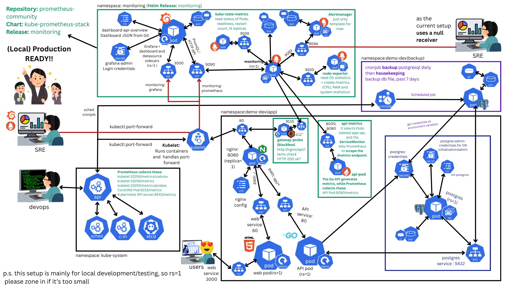
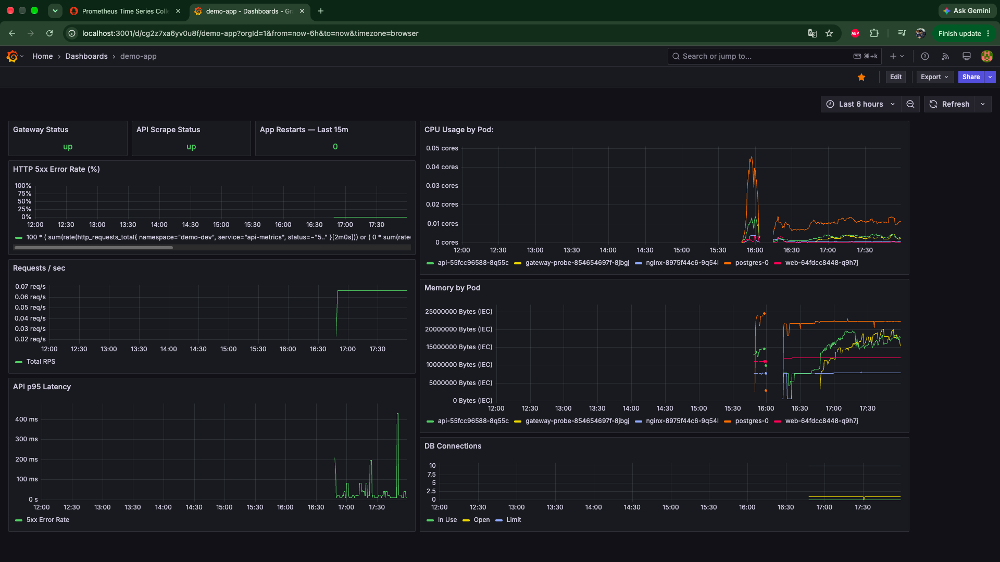
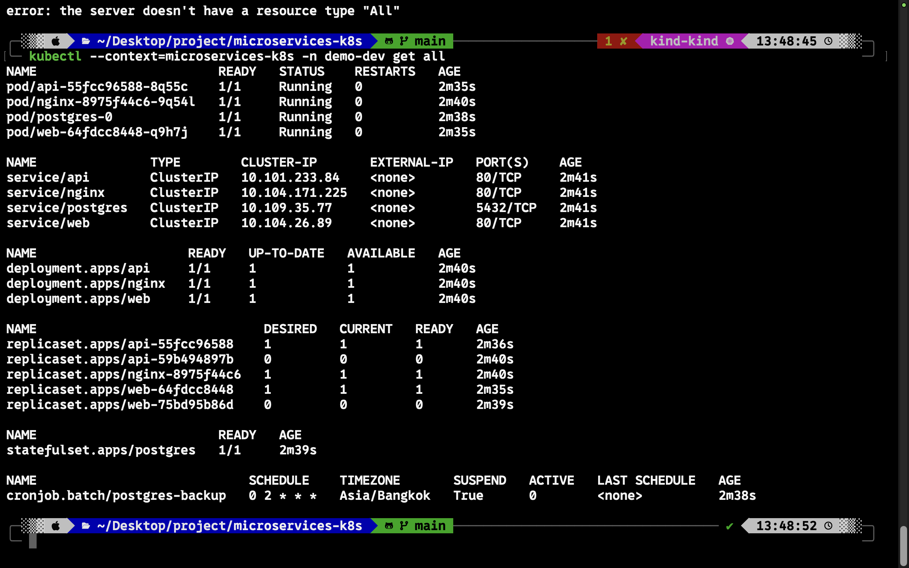
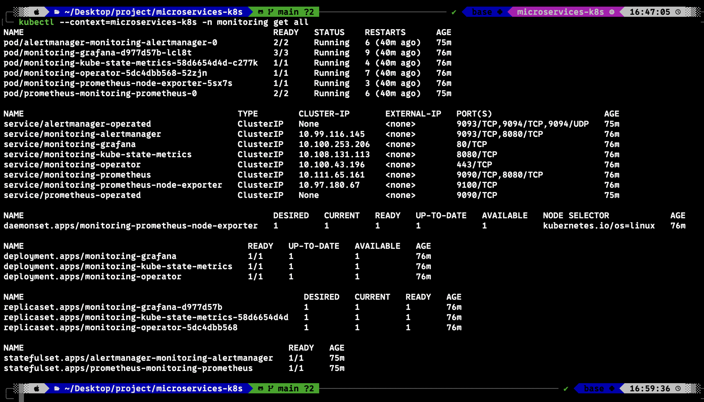
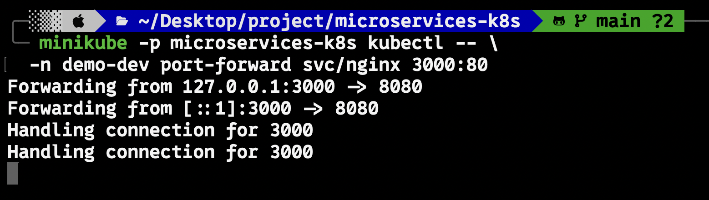
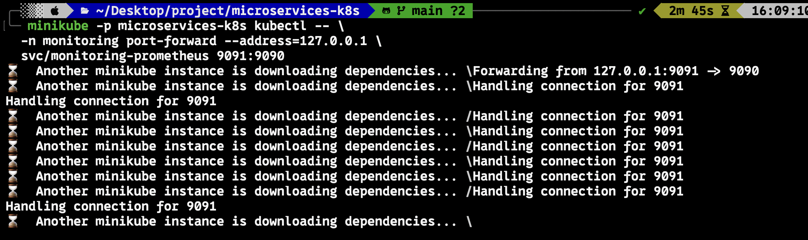
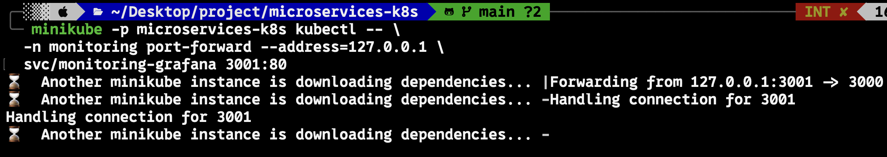

# Microservices K8s + monitoring

Node.js frontend, Go API, NGINX gateway, and PostgreSQL on Kubernetes with Kustomize.

## Architecture



# Monitoring Dashboard



| Panel | Description |
| ----- | ----------- |
| 1. Gateway Health | Checks whether the Gateway health probe succeeds (UP/DOWN). |
| 2. API Scrape Status | Checks whether Prometheus can successfully collect API metrics. |
| 3. App Restarts (15m) | Shows the number of container restarts in the last 15 minutes. |
| 4. HTTP Request Rate | Measures the average number of HTTP requests per second (RPS). |
| 5. HTTP 5xx Error Rate | Shows the percentage of HTTP requests that return server errors (5xx). |
| 6. API p95 Latency | Estimates the response time within which 95% of API requests complete. |
| 7. Database Pool Connections | Monitors active, open, and maximum allowed database connections in the API pool. |
| 8. CPU Usage by Pod | Shows CPU consumption for each Kubernetes Pod in cores or millicores. |
| 9. Memory Usage by Pod | Shows memory working-set usage for each Kubernetes Pod in MiB/GiB. |

[Final Grafana Dashboard JSON](App-Health-demo-dev-Final.json)

## Run locally

Start Docker Desktop (or Docker Engine on Linux). Run commands from the repository root.
Choose Kind or Minikube; Docker Desktop's built-in Kubernetes is not required.

### Kind

```bash
brew install kubectl kind # macOS, if needed
kind get clusters

# Create only if a cluster named "kind" does not exist
kind create cluster --name kind

bash scripts/kind.sh
kubectl --context=kind-kind -n demo-dev port-forward svc/nginx 3000:80
```

### Minikube

```bash
brew install kubectl minikube # macOS, if needed
bash scripts/minikube.sh
kubectl --context=microservices-k8s -n demo-dev port-forward svc/nginx 3000:80
```

Open **http://localhost:3000**. API: **http://localhost:3000/api/items**.
Keep port-forward running. Local access uses HTTP and needs no Ingress controller or ArgoCD.

Both scripts build and load images, deploy to `demo-dev`, and wait for readiness.
Rerun your setup script after code changes. Kind was verified locally;
Minikube is an alternative using 2 CPUs and 3 GiB of memory.

## Check the app

```bash
kubectl --context=kind-kind -n demo-dev get pods,pvc
curl --fail http://localhost:3000/api/items
```

For Minikube, use `--context=microservices-k8s`.
The API initially returns Item A, Item B, and Item C.

## Development checks



Go API tests, frontend security regressions, manifest assertions, and Kind
smoke, backup/restore, and database outage checks run in [CI](.github/workflows/ci.yaml).
See [regression commands and credential migration](docs/setup.md#database-credentials-and-existing-installations)
before upgrading an existing database. Only the local overlay ships demo secrets;
shared environments require separate admin and restricted application credentials.

## Backups

The [backup manifest](k8s/base/postgres/postgres-backup.yaml) creates a separate
backup PVC and a CronJob scheduled for 02:00 Bangkok time. It is suspended by
default. Each run uses `pg_dump`, then removes completed backups older than
7 days. Test backup and restore before enabling the schedule.

## Stop and resume

Stop Kind and its explicitly targeted port-forwards for the day. Database and
backup volumes are preserved; other Docker applications keep running.

```bash
bash scripts/local-cluster.sh stop
```

To resume, start Docker Desktop if needed, then run:

```bash
bash scripts/local-cluster.sh start
kubectl --context=kind-kind -n demo-dev port-forward svc/nginx 3000:80
```

Open **http://localhost:3000** and keep port-forward running.
Use `KIND_CLUSTER_NAME=my-cluster` with the script for a different Kind cluster.

For Minikube:

```bash
minikube stop -p microservices-k8s
# Resume later
bash scripts/minikube.sh
kubectl --context=microservices-k8s -n demo-dev port-forward svc/nginx 3000:80
```

## Remove the app

To remove this app from Kind, including its database and backup volume claims/data:

```bash
kubectl --context=kind-kind delete namespace demo-dev
```

## Project files

| Path              | Purpose                                                   |
| ----------------- | --------------------------------------------------------- |
| `services/`     | Application code and Dockerfiles                          |
| `k8s/base/`     | Shared Kubernetes manifests                               |
| `k8s/overlays/` | Local, dev, dev-cnpg, staging, and prod configuration     |
| `argocd/`       | GitOps application definitions; separate from local setup |
| `scripts/`      | Setup, cleanup, and diagram generation                    |

See the [setup and operations guide](docs/setup.md) for troubleshooting,
custom cluster names, ArgoCD configuration, and generated diagrams.

## Observability (optional)

Add Prometheus metrics, Grafana dashboards, Loki logs through Alloy, and alerts.
Normal application deployments do not require this stack.

### 1. Prepare the cluster

Install Helm 3, kubectl, and Python 3. Allocate at least **4 CPUs, 8 GiB RAM,
and 20 GiB free disk** to Docker/the cluster; VFS storage can require more disk.
Deploy the app using the Kind instructions above. For Minikube, use:

```bash
MINIKUBE_CPUS=4 MINIKUBE_MEMORY=8192 bash scripts/minikube.sh
```

Existing databases need the [credential migration](docs/setup.md#database-credentials-and-existing-installations)
before upgrading. This quick-start targets standalone PostgreSQL, not CNPG.

### 2. Create private monitoring credentials

Run from the repository root. For Minikube, set `KUBE_CONTEXT=microservices-k8s`.
Passwords are generated outside the checkout and are never committed.

```bash
export KUBE_CONTEXT=kind-kind
export APP_NAMESPACE=demo-dev
credentials_dir=$(mktemp -d)
chmod 700 "$credentials_dir"
python3 - "$credentials_dir" <<'PYTHON'
from pathlib import Path
import os, secrets, sys
for name in ('grafana-password', 'postgres-monitoring-password'):
    path = Path(sys.argv[1]) / name
    path.write_text(secrets.token_urlsafe(32))
    os.chmod(path, 0o600)
PYTHON
kubectl --context="$KUBE_CONTEXT" create namespace monitoring --dry-run=client -o yaml |
  kubectl --context="$KUBE_CONTEXT" apply -f -
kubectl --context="$KUBE_CONTEXT" -n monitoring create secret generic grafana-admin \
  --from-literal=admin-user=admin \
  --from-file="admin-password=$credentials_dir/grafana-password" \
  --dry-run=client -o yaml |
  kubectl --context="$KUBE_CONTEXT" -n monitoring apply --server-side -f -
bash scripts/monitoring/create-db-monitoring-role.sh "$credentials_dir/postgres-monitoring-password"
```

Save the generated Grafana password in your password manager before removing the
private temporary directory. The exporter receives its own monitoring role and
password, separate from the application and administrator credentials.

### 3. Install and open Grafana

```bash
bash scripts/monitoring/install.sh
kubectl --context="$KUBE_CONTEXT" -n monitoring port-forward --address=127.0.0.1 svc/monitoring-grafana 3001:80
```

Open **http://localhost:3001**. Sign in as **admin** with the password in
`$credentials_dir/grafana-password`, then open
**Microservices — API, database and logs** and select your application namespace.
Keep port-forward running. Rate and latency panels need several scrapes to fill.

### 4. Verify the stack

In another terminal, set the same `KUBE_CONTEXT` and `APP_NAMESPACE`, then run:

```bash
python3 scripts/test/test-monitoring.py
```

This checks scrape targets, database/gateway availability, API and pool metrics,
Loki log ingestion, and Grafana provisioning. External notifications are disabled
by default. Metrics stay internal and are not exposed through the public gateway.

See the [monitoring guide](docs/monitoring.md) for storage, network-policy
requirements, notification setup, validation, and removal, and the
[alert runbooks](docs/runbook.md) for troubleshooting. Run the database outage
exercise only in an isolated test namespace; it intentionally stops PostgreSQL.

### Resource of Kube's Monitoring



---

After starting Minikube and deploying the application and monitoring stack, use `kubectl port-forward` to access services from your browser.

Run each command in a **separate terminal**.

**1. Application (NGINX, terminal 1)**

```Shell
minikube -p microservices-k8s kubectl -- \
  -n demo-dev port-forward svc/nginx 3000:80
```

**2. Prometheus (terminal 2)**

```Shell
minikube -p microservices-k8s kubectl -- \
  -n monitoring port-forward svc/monitoring-prometheus 9091:9090
```

**3. Grafana (terminal 3)**

```Shell
minikube -p microservices-k8s kubectl -- \
  -n monitoring port-forward svc/monitoring-grafana 3001:80
```

**Local Access URLs**

| Service    | URL                                           | Purpose                 |
| ---------- | --------------------------------------------- | ----------------------- |
| NGINX      | [http://localhost:3000](http://localhost:3000) | Application entry point |
| Prometheus | [http://localhost:9091](http://localhost:9091) | Metrics & PromQL        |
| Grafana    | [http://localhost:3001](http://localhost:3001) | Monitoring dashboards   |

> **Note:** Port forwarding runs only while the terminal session remains active. Press `Ctrl+C` to stop. These endpoints are accessible locally and do not require exposing services externally.

One small improvement: you can use `kubectl` directly with the correct Minikube context if it's already configured, making the commands shorter:

```Shell
kubectl -n demo-dev port-forward svc/nginx 3000:80
kubectl -n monitoring port-forward svc/monitoring-prometheus 9091:9090
kubectl -n monitoring port-forward svc/monitoring-grafana 3001:80
```

example:

- demo-app:



- monitoring:






---
### Grafana Admin Login

Retrieve the Grafana admin password from the Kubernetes Secret:

```bash
minikube -p microservices-k8s kubectl -- \
  -n monitoring get secret grafana-admin \
  -o jsonpath='{.data.admin-password}' | base64 -d
echo
```

Open **http://localhost:3001** and sign in:

| Field | Value |
|---|---|
| Username | `admin` |
| Password | Output from the command above |

> **Note:** The password is stored as a Base64-encoded value in a Kubernetes Secret. Avoid committing credentials or command output to Git. and PostgreSQL exporter, Loki, and Alloy configurations are included as optional components. A core-only Prometheus/Grafana installation does not install them. The full scripts/monitoring/install.sh installer installs all three.


